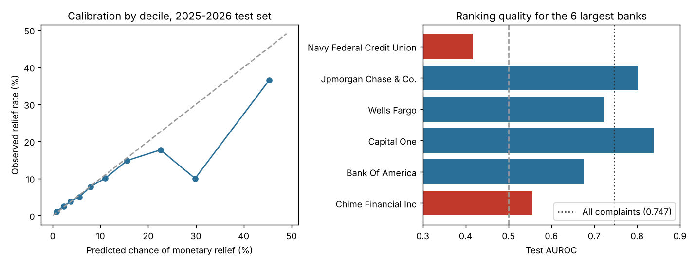

# ComplaintTriage: Which Bank Complaints Will End in Monetary Relief?

**The problem.** A bank's complaint team receives thousands of regulator-forwarded complaints. Some end with
the bank paying the customer back; most are closed with an explanation. If the team could spot the likely
refunds when a complaint arrives, it could fix them faster, before the customer escalates or the regulator
sees a pattern. This project scores each new complaint using only what is known on arrival, and checks
whether that score holds up on complaints from a later period.

**Data:** 184,902 real complaints about checking and savings accounts from the public
[CFPB Consumer Complaint Database](https://www.consumerfinance.gov/data-research/consumer-complaints/),
April 2017 to July 2026, each with the consumer's own written narrative (`data/README.md` has the pull and
checksum). **Target:** the company's final response was "Closed with monetary relief".
**Stack:** Python, pandas, scikit-learn, matplotlib, pytest.

## Design (`src/complainttriage/`)

- **Split by time, not at random:** train on 2017-2023 (87,044 complaints), choose the model on 2024
  (29,475), test once on 2025 to July 2026 (68,383). That's how the score would actually be used.
- **No outcome leakage:** fields filled in after the company responds ("Company public response",
  "Timely response?") are excluded, and a test checks they never enter the features.
- **Features:** sub-product, issue, sub-issue, company, state, channel and tags; from the narrative,
  TF-IDF words and word pairs, length, share of redacted text, and the dollar amounts mentioned.
- **Model:** logistic regression, so every driver can be read off its coefficient.

## Results (`results/results.json`)

| Model | Validation AUROC (2024) | Test AUROC (2025-26) |
|---|---|---|
| Structured fields only | 0.744 | 0.715 |
| Narrative text only | 0.738 | 0.709 |
| **Structured + text (chosen)** | **0.779** | **0.747** |

Adding the customer's own words to the structured fields raised test AUROC from 0.715 to 0.747. Test PR-AUC is
0.303 against a 0.110 base rate.

**What a review team would find** (68,383 test complaints, 7,487 ended in monetary relief):

| Review capacity | Complaints reviewed | Relief cases found | Precision | Share of all relief cases | Lift vs random |
|---|---|---|---|---|---|
| Top 5% of scores | 3,419 | 1,609 | 47.1% | 21.5% | 4.3x |
| Top 10% | 6,838 | 2,496 | 36.5% | 33.3% | 3.3x |
| Top 20% | 13,677 | 3,181 | 23.3% | 42.5% | 2.1x |



**Where it breaks, and why that matters:**
- **Drift.** The relief rate fell from 17.9% in training to 11.0% in the test period. Predictions are well
  calibrated up to about 15%, but the ninth decile predicts 29.8% and only 10.0% got relief.
- **Bank-level shifts.** For Navy Federal Credit Union the ranking is worse than random (AUROC 0.416): its relief
  rate in the test period is 4.4%, and what used to predict relief there no longer does. Chime is close to
  random (0.556). For JPMorgan Chase (0.802) and Capital One (0.838) it ranks well.
- **What raises the odds:** narratives mentioning fees, overdrafts, ATM problems, refunds, promotions and
  sign-up bonuses, and the sub-issue "Didn't receive terms that were advertised". **What lowers them:** narratives about
  scams, closed or locked accounts and refused requests, and the sub-issue "Account opened as a result of fraud".

**Recommendation:** use the score to order the review queue for most banks, but recalibrate it on recent
months, monitor AUROC per bank, and switch it off for any bank where it falls below 0.6 until retrained.

## Run

```bash
pip install -e ".[test]"
python -m complainttriage.model data/complaints_raw.csv   # writes results/results.json
python -m complainttriage.plots                            # writes results/summary.png
pytest -q
```

Training was run in steps (`prepare`, one fit per model, then `report`) using the same functions as `run()`.

## Limitations

- A complaint's outcome reflects the bank's decision, not necessarily who was right.
- Only complaints with a published narrative are included; consumers who don't share their story aren't in
  this sample.
- Dollar amounts come from the narrative text, which CFPB partially redacts.

## Changes from the earlier version

The earlier version had a feature script and a SAS model but had never been run on data. This version runs
on 184,902 real complaints, and every number above comes from `results/results.json`.

## License

Code in this repository is released under the MIT License (see `LICENSE`). Datasets and third-party files are not covered by this license and remain under their original sources' terms.
